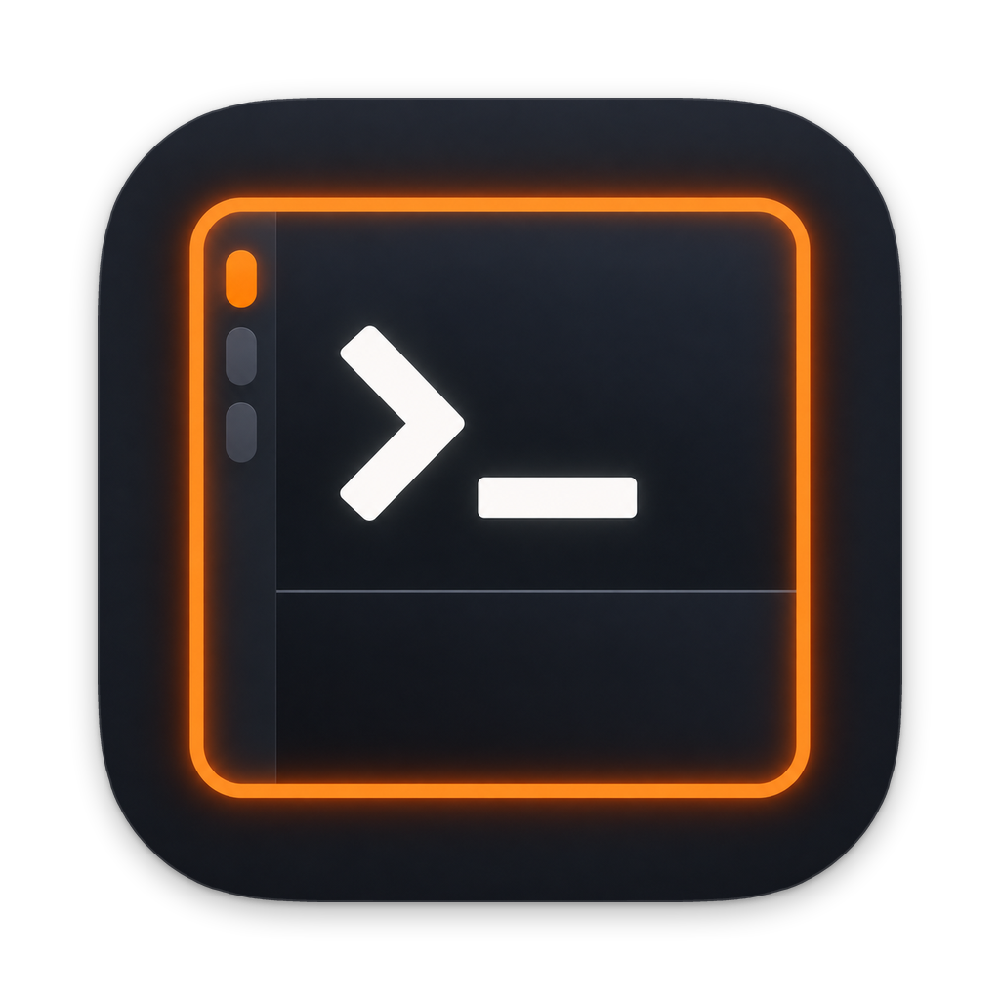

<p align="center"></p>

# cmds

[日本語](README.ja.md)

cmds is a native macOS terminal workspace for running AI coding agents. Workspaces sit in a vertical sidebar and
hold split panes of terminals (rendered by [libghostty](https://github.com/ghostty-org/ghostty)), web pages and live
file previews. A pane lights up when its agent needs you, the sidebar shows each agent's context, cost and account
limits, and a `cmds` command lets agents and scripts drive the app. An iPhone/iPad companion mirrors the terminals
over an encrypted connection. Written in Swift and AppKit. GPL-3.0.

## Features

- **Workspaces and splits**: vertical tabs with git branch, directory, listening ports, CPU and memory; nested
  right/down splits, zoom, compact sidebar.
- **Attention ring**: panes light up on OSC 9/777 notifications, the bell or `cmds notify`; ⇧⌘U jumps to the latest.
- **Browser panes**: WebKit next to your terminal, scriptable (`cmds browser eval`, `snapshot`).
- **Preview panes**: images, PDFs, video and Office files (Quick Look), rendered Markdown and coloured diffs, reloaded
  when the file changes; ⌘-click a path in the terminal to open it.
- **SSH workspaces**: your own `ssh` with a restricted socket forwarded to the server, so notifications, status and
  agent usage work remotely; reconnect overlay.
- **Coding agents**: Claude Code hooks and status-line reporter, Codex usage read from its session files; per-pane
  model, context, cost and 5-hour / 7-day / spend limits; a Claude Code skill.
- **Session restore and resume**: layout and directories come back after a restart, and Claude Code / Codex sessions
  are offered for resuming; export/import moves them to another instance.
- **`cmds` CLI and socket API**: split, send, read, notify, open, browse, list, stats, events — JSON on request.
- **iPhone/iPad companion**: QR pairing with TLS 1.3 pinned to the Mac's own certificate; connects over the local
  network (incl. peer-to-peer Wi‑Fi), Bluetooth LE when Wi‑Fi is off, or through an SSH relay host when away.
- **Keep awake**: no idle sleep while cmds runs; opt-in keep-awake with the lid closed.
- **English and Japanese** UI on both apps.

## Requirements

- Mac with Apple silicon, macOS 14 Sonoma or later (the app is built for arm64 only).
- iPhone/iPad with iOS/iPadOS 17 or later for the companion (optional).
- To build: Xcode (Swift 5.10, so Xcode 15.3 or later; developed with Xcode 27), [XcodeGen](https://github.com/yonaskolb/XcodeGen),
  and [Zig](https://ziglang.org) 0.17.0 (the version the pinned Ghostty requires; check with `zig version`, and get
  that exact release from ziglang.org if your package manager has another) to build GhosttyKit.

## Build from source

```sh
git clone --recurse-submodules https://github.com/nntokyo/cmds.git
cd cmds                                   # existing clone: git submodule update --init

# 1. GhosttyKit.xcframework from the Ghostty submodule
(cd vendor/ghostty && zig build -Demit-xcframework=true -Dxcframework-target=native \
  -Demit-macos-app=false -Doptimize=ReleaseFast)
ln -s "$PWD/vendor/ghostty/macos/GhosttyKit.xcframework" vendor/GhosttyKit.xcframework

# 2. Xcode project (generated, not committed)
brew install xcodegen
xcodegen generate

# 3. Mac app (scheme CmdsApp); open cmds.xcodeproj in Xcode instead if you prefer.
#    Not the maintainer? Sign with your own team (see Signing below).
xcodebuild -scheme CmdsApp -derivedDataPath build/dd DEVELOPMENT_TEAM=<your team id> build
open build/dd/Build/Products/Debug/cmds.app
```

- The iOS companion is the `CmdsCompanion` scheme; run it on your device from Xcode.
- **Signing**: `project.yml` signs with the maintainer's team (`DEVELOPMENT_TEAM: LY354RVYHA`). Set your own team
  there (or pass `DEVELOPMENT_TEAM=…` to `xcodebuild`) and run `xcodegen generate` again. Details and release builds:
  [docs/internals/release.md](docs/internals/release.md).
- The CLI alone: `swift build --package-path Packages/CmdsCore --product cmds`. Unit tests: `swift test` in
  `Packages/CmdsCore` ([testing](docs/internals/testing.md)).

## Install

1. Copy `cmds.app` to `/Applications` (or `~/Applications`) and open it from there.
2. If the macOS firewall is on, choose **Allow** when asked about incoming connections (needed for the iPhone
   companion). Allow notifications too.
3. Optional: **cmds › Install Command Line Tool…** links `/usr/local/bin/cmds` for terminals outside cmds (inside cmds
   it is already on `PATH`).

More: [docs/guide/getting-started.md](docs/guide/getting-started.md).

## Quick start

- **⌘N** opens a workspace, **⌘D** / **⇧⌘D** split right / down, **⇧⌘B** opens a browser split, **⇧⌘O** previews a
  file, **⇧⌘N** connects to a server over SSH.
- From a cmds terminal:

  ```sh
  cmds split down -- npm run dev            # dev server in a new pane below
  cmds browser open http://localhost:3000   # browser pane on the right
  git diff | cmds open --diff -             # coloured diff in a preview pane
  long-task; cmds notify "done: $?"         # light this pane when finished
  ```

- Coding agents: add the Claude Code hooks and status line, and turn on Codex notifications —
  [docs/guide/ai-agents.md](docs/guide/ai-agents.md).
- iPhone: **cmds › Pair iPhone/iPad…** on the Mac, then **Scan Pairing Code** in the companion —
  [docs/guide/iphone.md](docs/guide/iphone.md).

## Keyboard shortcuts

| Action | Key |
|---|---|
| New workspace / new SSH workspace | ⌘N / ⇧⌘N |
| Select workspace 1–9 | ⌘1 … ⌘9 |
| Next / previous workspace | ⇧⌘] / ⇧⌘[, ⌃Tab / ⌃⇧Tab |
| Rename workspace | ⇧⌘R |
| Split right / down | ⌘D / ⇧⌘D |
| Focus pane left / right / up / down | ⌥⌘← / → / ↑ / ↓ |
| Zoom pane | ⇧⌘↩ |
| Jump to latest attention | ⇧⌘U |
| Open browser split / open in preview | ⇧⌘B / ⇧⌘O |
| Address bar / reload (or reconnect SSH) / back / forward | ⌘L / ⌘R / ⌘[ / ⌘] |
| Close pane / close workspace | ⌘W / ⇧⌘W |
| Toggle sidebar / compact sidebar | ⌘B / ⌃⌘S |

All shortcuts: [docs/reference/shortcuts.md](docs/reference/shortcuts.md).

## Documentation

| Guides | Reference | Internals |
|---|---|---|
| [Getting started](docs/guide/getting-started.md) | [CLI](docs/reference/cli.md) | [Architecture](docs/internals/architecture.md) |
| [Workspaces and panes](docs/guide/workspaces-and-panes.md) | [Socket API](docs/reference/api.md) | [Sync protocol](docs/internals/sync-protocol.md) |
| [iPhone and iPad](docs/guide/iphone.md) | [Keyboard shortcuts](docs/reference/shortcuts.md) | [SSH panes](docs/internals/ssh.md) |
| [AI coding agents](docs/guide/ai-agents.md) | [Environment variables](docs/reference/environment.md) | [Localization](docs/internals/localization.md) |
| | | [Testing](docs/internals/testing.md) |
| | | [Release](docs/internals/release.md) |

Index: [docs/README.md](docs/README.md). Changes: [CHANGELOG.md](CHANGELOG.md).

## License

cmds is free software under the [GNU General Public License v3.0](LICENSE).

### Third-party software

| Component | Used by | License |
|---|---|---|
| [Ghostty](https://github.com/ghostty-org/ghostty) (libghostty, terminfo and shell-integration resources; submodule `vendor/ghostty`) | Mac app | MIT ([vendor/ghostty/LICENSE](https://github.com/ghostty-org/ghostty/blob/main/LICENSE)); Ghostty's own dependencies are listed in its repository |
| [Sparkle](https://github.com/sparkle-project/Sparkle) 2 (automatic updates) | Mac app | MIT ([LICENSE](https://github.com/sparkle-project/Sparkle/blob/2.x/LICENSE)) |
| [SwiftNIO SSH](https://github.com/apple/swift-nio-ssh), [SwiftNIO](https://github.com/apple/swift-nio), [SwiftNIO Transport Services](https://github.com/apple/swift-nio-transport-services), [Swift Crypto](https://github.com/apple/swift-crypto), and their dependencies swift-asn1, swift-atomics, swift-collections, swift-system | iOS companion (`Packages/CmdsSSH`) | Apache-2.0 |

The Mac app uses only Apple frameworks besides libghostty and Sparkle; the `cmds` CLI only Apple frameworks.
